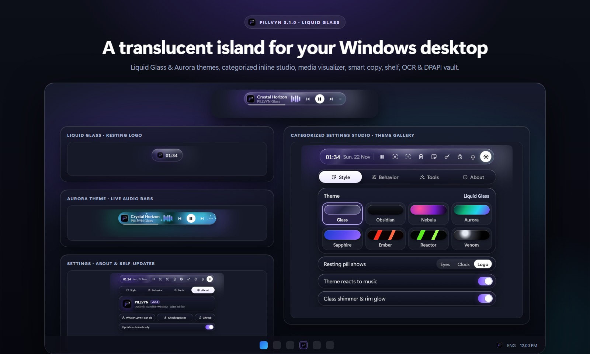

<div align="center">


# PILLVYN

**A sleek, translucent Dynamic Island for Windows.** One refined pill at the top of your screen that shows what is playing,
catches your notifications, remembers what you copied, holds your files, and adapts in real time with Liquid Glass & animated themes.

[](https://github.com/EbramJames/PILLVYN/releases/latest)
[](https://github.com/EbramJames/PILLVYN/releases)
[](https://github.com/EbramJames/PILLVYN/actions/workflows/build.yml)

[](LICENSE)

[](https://github.com/EbramJames/PILLVYN/releases/latest/download/PILLVYN-Setup.exe)
[](https://github.com/EbramJames/PILLVYN/releases/latest/download/PILLVYN-Portable.exe)
[](https://github.com/EbramJames/PILLVYN/releases/latest/download/PILLVYN-Windows.zip)

[Changelog](CHANGELOG.md) · [Contributing](CONTRIBUTING.md) · [Security](SECURITY.md) · [فارسی](#فارسی)



</div>

## What it does

- **Liquid Glass & Dynamic Themes.** Translucent frosted glass-morphism (`Liquid Glass`) with optical specular highlights, cursor-reactive rim light, state-change shimmer sweeps, and audio-reactive dispersion — alongside **Obsidian**, **Nebula**, **Aurora**, **Sapphire**, **Ember**, **Reactor**, and **Venom**.
- **Now playing.** Title, artist, album art, gradient audio visualizer bars, transport controls, and an interactive hover scrubber for Windows media sessions. Films and fullscreen games are left alone.
- **Categorized Settings Studio inside the island.** Clean **Style**, **Behavior**, **Tools**, and **About** tabs with a visual 4×2 Theme Gallery and resting pill styles (**Eyes**, **Clock**, or **Logo**) — zero extra windows.
- **Notifications in one line.** Click to open that chat. While you are using the pill, incoming alerts wait neatly beside it instead of interrupting.
- **One hover away.** Screenshot, text grab, clipboard history, quick note, passwords, timer, file shelf, notifications, and settings.
- **Smart copy.** Copied links open in one click, math expressions show their answer, dates convert Gregorian ⇄ Shamsi, and hex colours preview their swatch.
- **File shelf.** Drop up to five files onto the pill and drag them back out whenever you need them.
- **Quick notes & reminders.** `Ctrl+Alt+N` from anywhere (`call Ali in 20m`, `at 18:30 gym`, «۱۰ دقیقه دیگه چای»).
- **Encrypted passwords.** Generate and store credentials protected with your Windows account (DPAPI); copied passwords clear from the clipboard after 30 seconds.
- **Offline text grab (OCR).** `Ctrl+Alt+T`, drag a box over any screen region to copy English (Windows OCR) or Persian (bundled Tesseract). Everything stays local.
- **Small signs.** Subtle dots while the microphone or camera is active, VPN/network transitions, Bluetooth & charger alerts, and a persistent countdown timer.
- **Verified self-updates.** Releases download from GitHub Releases and verify their SHA-256 checksum before installing silently.

On its first start PILLVYN greets you and offers *What PILLVYN can do* (always accessible under **Settings → About**).

## Install

Download **[PILLVYN-Setup.exe](https://github.com/EbramJames/PILLVYN/releases/latest/download/PILLVYN-Setup.exe)** and run it.
It installs per-user into `%LOCALAPPDATA%\Programs\PILLVYN` (no administrator prompt) and starts with Windows; both can be configured in **Settings → Behavior**.

Requires Windows 10 or 11 with the WebView2 runtime (built into Windows 11 and modern Windows 10).

> Because the installer is not EV code-signed, Windows SmartScreen may ask once for confirmation. Verify integrity using [PILLVYN-Setup.exe.sha256](https://github.com/EbramJames/PILLVYN/releases/latest/download/PILLVYN-Setup.exe.sha256).

## Privacy

PILLVYN makes no network requests except checking this repository for a new release (which can be disabled in **Settings → About**).
Notifications, clipboard history, notes, OCR scans, and encrypted passwords remain strictly on your device. See [SECURITY.md](SECURITY.md) for details.

## Build & Package

```powershell
# Build & package installer, portable exe, zip, SHA-256 checksums, and latest.json
powershell -ExecutionPolicy Bypass -File scripts/package.ps1
```

Or build the Rust binary directly:

```powershell
cd src-tauri
cargo build --release --locked
```

Icons can be regenerated anytime from master artwork with `scripts/generate-icons.ps1`. See [CONTRIBUTING.md](CONTRIBUTING.md) for development checks and architecture layout.

## License

[MIT](LICENSE). Bundles `tesseract.js` and Tesseract's Persian trained data (Apache 2.0) in `ui/ocr/`.

---

<div dir="rtl">

## فارسی

**PILLVYN یک جزیرهٔ زنده و شیشه‌ای برای ویندوز است.** یک قرص ظریف در بالای صفحه که آهنگ در حال پخش را نشان می‌دهد،
نوتیفیکیشن‌ها را می‌گیرد، چیزهایی که کپی کرده‌ای یادش می‌ماند، فایل‌هایت را نگه می‌دارد و با تم **Liquid Glass** (شیشه‌مورفیسم) و افکت‌های زنده همراهت است.

### امکانات

- **تم شیشه‌ای (Liquid Glass) و تم‌های متحرک:** نمای نیمه‌شفاف شیشه‌ای با انعکاس نور در لبه‌ها و واکنش به مکان‌نما، به‌همراه تم‌های **Obsidian**، **Nebula**، **Aurora**، **Sapphire**، **Ember**، **Reactor** و **Venom**.
- **تنظیمات دسته‌بندی‌شده داخل خود جزیره:** چهار تب منظم (**Style**، **Behavior**، **Tools**، **About**) با گالری تصویری تم‌ها و انتخاب حالت استراحت جزیره (**Eyes**، **Clock** یا **Logo**).
- **پخش موزیک:** نام آهنگ، خواننده، کاور، اکولایزر گرادیانی زنده، دکمه‌های کنترل و نوار جلو و عقب بردن. با فیلم و بازی تمام‌صفحه کاری ندارد.
- **نوتیفیکیشن در یک خط:** با کلیک همان چت باز می‌شود؛ هنگام کار با جزیره کنار آن منتظر می‌ماند.
- **کپی هوشمند:** لینک‌ها باز می‌شوند، عبارات ریاضی حساب می‌شوند، تاریخ میلادی و شمسی به هم تبدیل می‌شوند و کد رنگ‌ها نمایش داده می‌شوند.
- **نگه‌داشتن فایل:** فایل را روی جزیره رها کن تا کنار هم بمانند و هر وقت خواستی بیرونشان بکشی.
- **یادداشت سریع:** `Ctrl+Alt+N` از هر جا. اگر در متن زمان باشد («۱۰ دقیقه دیگه چای») یادآور می‌شود.
- **رمزها:** رمز می‌سازد و با رمزنگاری حساب ویندوز (DPAPI) ذخیره می‌کند؛ رمز کپی‌شده پس از ۳۰ ثانیه پاک می‌شود.
- **خواندن متن از صفحه (OCR آفلاین):** `Ctrl+Alt+T`، دور متن کادر بکش؛ انگلیسی و فارسی بدون ارسال هیچ داده‌ای به اینترنت.
- **آپدیت خودکار امن:** بررسی چک‌سام SHA-256 پیش از نصب خودکار نسخهٔ جدید.

### نصب

فایل **[PILLVYN-Setup.exe](https://github.com/EbramJames/PILLVYN/releases/latest/download/PILLVYN-Setup.exe)** را دانلود و اجرا کن.
فقط برای کاربر فعلی نصب می‌شود و دسترسی ادمین نمی‌خواهد.

### حریم خصوصی

PILLVYN هیچ درخواست اینترنتی‌ای نمی‌فرستد، به‌جز بررسی همین مخزن برای نسخهٔ جدید (که در تنظیمات خاموش می‌شود).
نوتیفیکیشن‌ها، کلیپ‌بورد، یادداشت‌ها و رمزها روی سیستم خودت می‌مانند.

</div>
