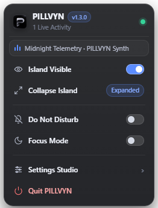
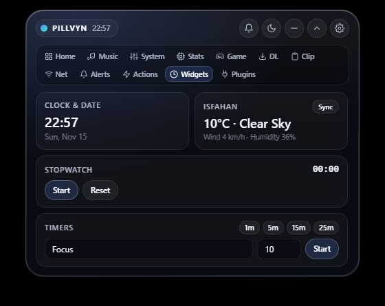

<p align="center">
  
</p>

<h1 align="center">PILLVYN</h1>

<p align="center">
  <strong>Minimal, responsive Dynamic Island desktop hub for Windows 10 and Windows 11.</strong><br/>
  Built with Rust, Tauri 2, HTML5, CSS3, and Vanilla JavaScript — packaged with NSIS.
</p>

<p align="center">
  <a href="https://github.com/EbramJames/PILLVYN/releases/latest"></a>
  <a href="LICENSE"></a>
  
  
</p>

---

## Overview

**PILLVYN** places a quiet, dark-glassmorphic Dynamic Island capsule at the top-center of your Windows monitor. It stays click-through outside the capsule bounds so windows underneath remain completely unobstructed, never steals focus unnecessarily, and morphs smoothly between **Minimized**, **Compact**, and **Expanded** states using natural spring physics and intuitive gestures.

## Screenshots

<p align="center">
  
</p>

| Expanded Hub | Monitor (`Hardware / Net / Downloads / Gaming`) |
| :---: | :---: |
|  |  |

| Redesigned Settings Studio | Custom Obsidian Glass Tray Menu |
| :---: | :---: |
|  |  |

| Tools (`Timers / Shortcuts / Plugins / AI`) |
| :---: |
|  |

## Features & v1.3.0 Highlights

- **Zero-Spawn Windows Integration & Taskbar Cleanliness**:
  - Replaced background `netsh.exe` and `powershell.exe` child-process polling with pure in-process Windows `GetIfTable2` IEEE 802.11 link detection and native COM `IWbemLocator` + DDC/CI brightness — eliminating the Windows 11 taskbar Location Services (`Network Command Shell`) indicator flicker and background cursor flashes.
  - Enforced `WS_EX_TOOLWINDOW` (stripping `WS_EX_APPWINDOW`) on frameless capsule and tray windows with work-area-clamped dynamic resizing.
- **Hardened Drag Sliders & End-to-End Button Sync**:
  - Expanded slider drag hitboxes across Hub, Media, Controls, and Settings Studio (`createRangeSlider`), protected active slider drags against background panel re-renders and accidental swipe gestures, synchronized factory defaults (`0.88` opacity, `2000ms` telemetry interval, `25` clipboard items), and added live `%`/timestamp readouts during dragging.
  - Fixed the **Wi-Fi Flyout** (`ms-availablenetworks:`) URI handler, kept Clipboard search input focus intact across live filtering, preserved AI prompt drafts across updates, allowed pre-save update checks from Settings Studio, synchronized `Expand`/`Hide` sidebar controls & tray states cleanly, and surfaced actionable inline error notices.
- **Custom Obsidian Glass Tray Menu & Full State Sync**:
  - Replaced the native Windows tray right-click menu with a lightweight frameless Obsidian Glass popover showing active Live Status, Now Playing strip, toggle switches for **Island Visible**, **Do Not Disturb**, and **Focus Mode**, quick **Expand / Collapse**, **Settings Studio**, and **Quit** — automatically positioned inside the active monitor work area whether opened from the taskbar or the Windows tray overflow flyout.
  - Real-time state synchronization (`pillvyn://island-state`, live appearance preview, startup Windows autostart sync, and clean disabling of background monitors/HUD overrides when a module is turned off).
- **Redesigned 5-Tab Settings Studio**:
  - Cleanly organized into **Appearance**, **Display & Behavior**, **Modules & Tools**, **Shortcuts & Apps**, and **Privacy & System** with a live Capsule Preview stage, curated Accent swatches working across every theme, interactive range sliders with filled tracks & single-click defaults, keystroke recorder for global hotkeys, and full management for Quick Actions and Per-App Rules.
- **Quiet Obsidian Glass UI & Dynamic Island Core**:
  - Frameless, layered obsidian glass with uniform monochrome SVG icons and clean typography.
  - Streamlined **7-tab Expanded Dock** (`Hub`, `Media`, `Controls`, `Monitor`, `Alerts`, `Clip`, `Tools`) with segmented sub-views so the pill stays calm and uncluttered.
  - **Intuitive Gestures & Controls**:
    - Hover the Compact pill to reveal inline playback controls (**Hover-to-Peek**).
    - Scroll the mouse wheel over Compact to adjust master volume (`Shift+Wheel` for brightness where supported).
    - Swipe horizontally on Compact to skip tracks or cycle Live Activities; swipe down to Expand, swipe up to Minimize.
    - Swipe left/right inside Expanded to move across tabs; swipe up to Collapse.
    - Click anywhere outside Expanded to auto-dismiss cleanly — or click the header **Pin** button to lock the hub open while working.
    - Keyboard shortcuts inside Expanded: `Escape` to collapse, `ArrowLeft`/`ArrowRight` to switch tabs, `Space` for play/pause.
- **Event-Driven Synchronization & Multiple Live Activities**:
  - **WinRT GSMTC Listeners**: Event-driven track/timeline updates across multiple simultaneous media sessions with instant source switching (Spotify, Chrome, Edge, Firefox, Opera, Yandex Browser, VLC, Apple Music, Amazon Music, MusicBee, Winamp, mpv, Kodi).
  - **WASAPI CoreAudio Callbacks**: `IAudioEndpointVolumeCallback` + `IMMNotificationClient` wake PILLVYN immediately when hardware volume keys, mute buttons, or default audio devices change, briefly flashing the system HUD without polling spam.
  - **Win32 Foreground & Fullscreen Sync**: `SetWinEventHook` + `SHQueryUserNotificationState` apply per-app profiles automatically without stealing focus or spawning child CLI processes.
- **System Controls & Hardware Monitor**: Master/mic gain & mute, default device switching (`IPolicyConfig`), cached WMI/DDC-CI display brightness where exposed by the monitor, CPU/RAM/Disk (`sysinfo`), DXGI/PDH GPU load, and NVIDIA NVML temperatures/VRAM/wattage where supported.
- **Anti-Cheat Safe Gaming, Downloads, Clipboard & Network**: Native registry Steam `RunningAppID` & process detection without DLL injection, `.crdownload`/`.part`/`.opdownload`/Steam `.acf` download ETA, `AddClipboardFormatListener` history with secret filtering, `GetIfTable2` throughput, ICMP latency, and VPN detection.
- **Tools, Plugins, Optional AI & Updater**: Quick shortcuts with strict scheme validation, countdown timers, stopwatch, 12h/24h clock & Open-Meteo weather, local `plugin.json` manifests (`%APPDATA%\pillvyn\PILLVYN\config\plugins`), strictly opt-in local Ollama/OpenAI-compatible AI, global hotkeys with duplicate validation, Windows autostart, and consent-gated GitHub Release updates.

## Installation

1. Download the latest x64 Windows setup executable (**[`PILLVYN_1.3.0_x64-setup.exe`](https://github.com/EbramJames/PILLVYN/releases/latest)**) from **Releases**.
2. Run the NSIS installer (supports **Current User** or **All Users**, Start Menu & Desktop shortcuts, clean upgrade shutdown, and automatic Microsoft Edge WebView2 verification).
3. Verify integrity (optional): compare against `PILLVYN_1.3.0_x64-setup.exe.sha256`.
4. Launch **PILLVYN** from the Start Menu or system tray.

> **Default Global Hotkeys:**
> - `Alt+Shift+Space`: Expand / Collapse Island
> - `Ctrl+Alt+H`: Show / Hide Island
> - `Ctrl+Alt+D`: Toggle Do Not Disturb
> - `Alt+Shift+V`: Open Clipboard Drawer

## Architecture

```text
PILLVYN/
├── src/                        # Vanilla JS, HTML5, CSS3 frontend (zero framework overhead)
│   ├── index.html              # Floating Dynamic Island capsule UI
│   ├── settings.html           # Dedicated 5-section Settings Studio window
│   ├── tray.html               # Custom Obsidian Glass taskbar tray popover
│   ├── styles/                 # Quiet Obsidian Glass tokens, island, module, tray & settings styles
│   └── js/                     # Store, theme engine, core gestures, tray/settings & 12 modules
├── src-tauri/
│   ├── capabilities/           # Restrictive per-window Tauri v2 capability definitions
│   ├── nsis/                   # NSIS installer hooks & branded wizard bitmaps
│   └── src/
│       ├── config.rs           # Validated atomic JSON config persistence (v2 schema + auto-migration)
│       ├── commands.rs         # Validated IPC command layer & asynchronous wakeup handles
│       ├── island/             # Multi-monitor DPI geometry, click-outside & click-through controller
│       └── services/           # Event-driven Windows Win32/WinRT, WASAPI & telemetry integrations
├── docs/website/               # Static official product website (GitHub Pages ready)
└── .github/                    # CI/CD workflows, issue templates, PR template
```

## Building from Source

### Prerequisites (Windows 10/11 x64)
- [Rust](https://rustup.rs/) (`stable-x86_64-pc-windows-msvc`, 1.82+)
- Visual Studio Build Tools 2022 (*Desktop development with C++* + Windows 10/11 SDK)
- [Node.js](https://nodejs.org/) 20+
- [NSIS 3.x](https://nsis.sourceforge.io/) (for `npm run build` installer generation)
- Microsoft Edge WebView2 Runtime (pre-installed on Windows 11 and modern Windows 10)

### Commands
```bash
# Install Tauri CLI & JS packages
npm install

# Run frontend syntax checks
npm run check:frontend

# Run Rust tests
cargo test --manifest-path src-tauri/Cargo.toml

# Run in development mode
npm run dev

# Build release binary + NSIS Windows setup executable
npm run build
```

## Platform Notes & Honest Limitations
- **Windows Action Center (`UserNotificationListener`)**: Windows restricts reading global Action Center toast history to apps with MSIX Package Identity. When distributed as an unpackaged NSIS Win32 app, PILLVYN transparently switches to its internal/plugin/timer/download Notification Hub without faking OS toasts.
- **FPS Telemetry**: To remain 100% safe around anti-cheat systems (Vanguard, EAC, BattlEye), PILLVYN does not inject hooks into DirectX/Vulkan games; Gaming Mode reports live CPU, RAM, GPU, VRAM, and Steam state without risky injection.
- **Display Brightness**: Laptop internal displays support WMI brightness; desktop external monitors require DDC/CI enabled in the monitor OSD. Unsupported displays are reported clearly rather than simulated.
- **CPU Temperatures**: Windows does not expose standardized unprivileged CPU die temperature APIs across all motherboards without ring-0 kernel drivers; temperatures are shown when reported by ACPI/NVML sensors and omitted cleanly otherwise.

## Contributing & Security
- See [CONTRIBUTING.md](CONTRIBUTING.md) for guidelines and plugin development instructions.
- See [SECURITY.md](SECURITY.md) for our security model and vulnerability reporting process.

## License
Released under the [MIT License](LICENSE).
