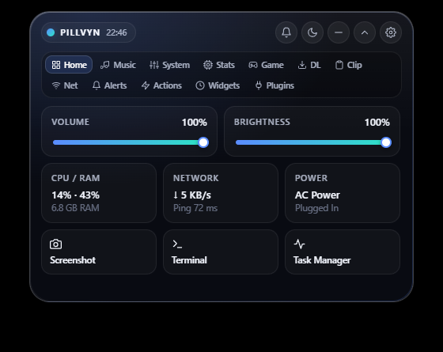
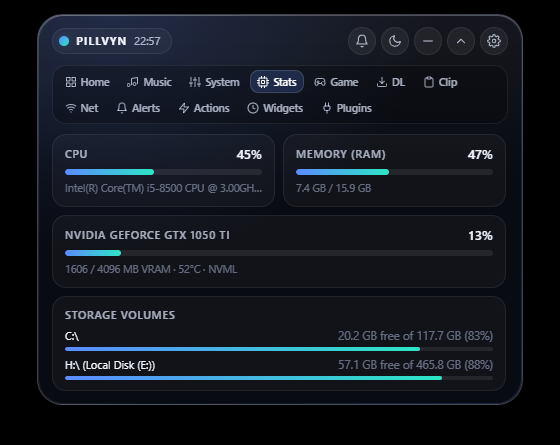
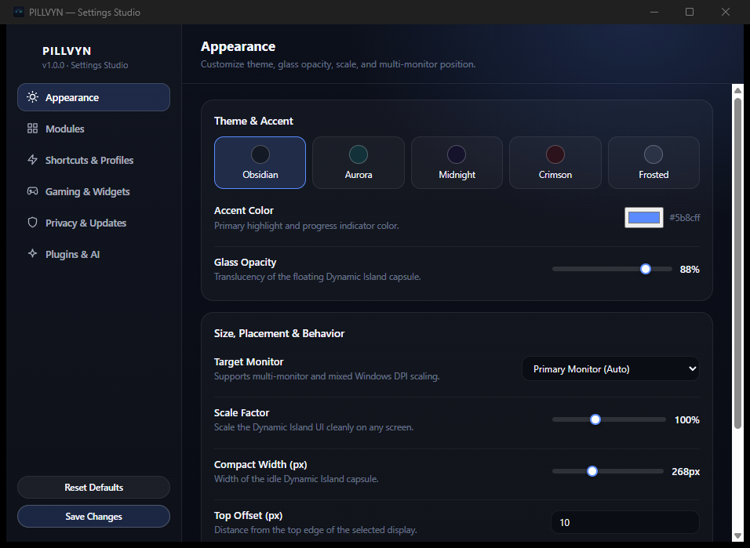

<p align="center">
  
</p>

<h1 align="center">PILLVYN</h1>

<p align="center">
  <strong>Premium, lightweight Dynamic Island desktop hub for Windows 10 and Windows 11.</strong><br/>
  Built with Rust, Tauri 2, HTML5, CSS3, and Vanilla JavaScript — packaged with NSIS.
</p>

<p align="center">
  <a href="LICENSE"></a>
  
  
</p>

---

## Overview

**PILLVYN** places a sleek, dark-glassmorphic Dynamic Island capsule at the top-center of your Windows monitor. It stays completely click-through outside the pill bounds so your workflow underneath is never obstructed, and smoothly morphs between **Minimized**, **Compact**, and **Expanded** states when you interact or receive Live Activities.

## Screenshots

<p align="center">
  
</p>

| Expanded Home Dashboard | Live Hardware &amp; NVML GPU Telemetry |
| :---: | :---: |
|  |  |

| Clock, Stopwatch, Timers &amp; Weather | Dedicated Settings Studio |
| :---: | :---: |
|  |  |

## Features

- **Dynamic Island Core**: Frameless transparent glass capsule with spring animations, Minimized/Compact/Expanded modes, multi-monitor selection, mixed-DPI scaling support, and smart cursor hit-testing click-through.
- **Multiple Simultaneous Live Activities**: Priority-sorted live strip combining Media, Downloads, Timers, Gaming, Notifications, System HUD changes, and Plugin cards.
- **Music Player (Windows GSMTC)**: Detects active Windows media sessions (Spotify, Chrome, Edge, Firefox, VLC, Apple Music), extracts album artwork, shows seekable timeline, and provides transport controls.
- **System Controls**: WASAPI CoreAudio master & microphone volume/mute, default output/input audio device switching (`IPolicyConfig`), display brightness (WMI internal panels & DDC/CI external monitors where supported), battery/power telemetry, and Windows connectivity quick links.
- **Hardware Monitor**: Live CPU, RAM, and disk volume usage via `sysinfo`, DXGI GPU adapter discovery, Windows PDH 3D GPU load, and NVIDIA NVML temperatures/VRAM/power where supported.
- **Gaming Mode (Anti-Cheat Safe)**: Detects Steam `RunningAppID`, known game executables, custom game processes, and fullscreen apps; automatically suppresses non-critical alerts, supports Click-Through HUD mode, and surfaces running ecosystem apps (Steam, Discord, OBS, Spotify, VLC, Browsers) without DLL injection.
- **Download Monitor**: Real-time tracking of active Chromium/Firefox/Opera partial downloads (`.crdownload`, `.part`, `.opdownload`) and Steam `appmanifest_*.acf` downloads with speed and ETA.
- **Clipboard Manager**: Zero-polling Win32 `AddClipboardFormatListener` capture for text and image previews, search filter, pin/delete/clear, and sensitive token filtering.
- **Network Monitor**: Real adapter Rx/Tx throughput (`GetIfTable2`), periodic ICMP ping latency, and active VPN adapter detection (WireGuard, WireSock, OpenVPN, Tailscale, Wintun, etc.).
- **Quick Actions & Widgets**: Validated Windows system tools & URL shortcuts, clock, preset/custom countdown timers, stopwatch, and Open-Meteo weather with offline cache.
- **Plugins & Optional AI**: Local `plugin.json` manifest loader (`%APPDATA%\pillvyn\PILLVYN\config\plugins`), automatic application profiles, global shortcuts, Windows autostart, system tray, and strictly opt-in local Ollama / OpenAI-compatible AI assistant.

## Installation

1. Download the latest x64 Windows setup executable (`PILLVYN_1.0.0_x64-setup.exe`) from **Releases**.
2. Run the NSIS installer (supports **Current User** or **All Users**, Start Menu & Desktop shortcuts, clean upgrade shutdown, and automatic Microsoft Edge WebView2 bootstrap if missing).
3. Launch **PILLVYN** from the Start Menu or system tray.

> **Default Global Hotkeys:**
> - `Alt+Shift+Space`: Expand / Collapse Island
> - `Ctrl+Alt+H`: Show / Hide Island
> - `Ctrl+Alt+D`: Toggle Do Not Disturb
> - `Alt+Shift+V`: Open Clipboard Drawer

## Architecture

```text
PILLVYN/
├── src/                        # Vanilla JS, HTML5, CSS3 frontend (zero framework overhead)
│   ├── index.html              # Floating Dynamic Island capsule UI
│   ├── settings.html           # Dedicated Settings Studio window
│   ├── styles/                 # Design tokens, island animations, module & settings styles
│   └── js/                     # Store, safe DOM helpers, core state machine, 12 module renderers
├── src-tauri/
│   ├── capabilities/           # Restrictive per-window Tauri v2 capability definitions
│   ├── nsis/                   # NSIS installer hooks & branded wizard bitmaps
│   └── src/
│       ├── config.rs           # Validated atomic JSON config persistence
│       ├── commands.rs         # Validated IPC command layer
│       ├── island/             # Multi-monitor DPI geometry, click-through hit-testing, Live Activities
│       └── services/           # Independent Windows Win32/WinRT & OS service integrations
├── docs/website/               # Static official product website (GitHub Pages ready)
└── .github/                    # CI/CD workflows, issue templates, PR template
```

## Building from Source

### Prerequisites (Windows 10/11 x64)
- [Rust](https://rustup.rs/) (`stable-x86_64-pc-windows-msvc`, 1.82+)
- Visual Studio Build Tools 2022 (*Desktop development with C++* + Windows 10/11 SDK)
- [Node.js](https://nodejs.org/) 20+
- [NSIS 3.x](https://nsis.sourceforge.io/) (for `npm run build` installer generation)
- Microsoft Edge WebView2 Runtime (pre-installed on Windows 11 and modern Windows 10)

### Commands
```bash
# Install Tauri CLI & JS packages
npm install

# Run frontend syntax checks
npm run check:frontend

# Run Rust tests
cargo test --manifest-path src-tauri/Cargo.toml

# Run in development mode
npm run dev

# Build release binary + NSIS Windows setup executable
npm run build
```

## Platform Notes & Honest Limitations
- **Windows Action Center (`UserNotificationListener`)**: Windows restricts reading global Action Center toast history to apps with MSIX Package Identity. When distributed as an unpackaged NSIS Win32 app, PILLVYN transparently switches to its internal/plugin/timer/download Notification Hub without faking OS toasts.
- **FPS Telemetry**: To remain 100% safe around anti-cheat systems (Vanguard, EAC, BattlEye), PILLVYN does not inject hooks into DirectX/Vulkan games; Gaming Mode reports live CPU, RAM, GPU, VRAM, and Steam state without risky injection.
- **Display Brightness**: Laptop internal displays support WMI brightness; desktop external monitors require DDC/CI enabled in the monitor OSD. Unsupported displays are reported clearly rather than simulated.
- **CPU Temperatures**: Windows does not expose standardized unprivileged CPU die temperature APIs across all motherboards without ring-0 kernel drivers; temperatures are shown when reported by ACPI/NVML sensors and omitted cleanly otherwise.

## Contributing & Security
- See [CONTRIBUTING.md](CONTRIBUTING.md) for guidelines and plugin development instructions.
- See [SECURITY.md](SECURITY.md) for our security model and vulnerability reporting process.

## License
Released under the [MIT License](LICENSE).
